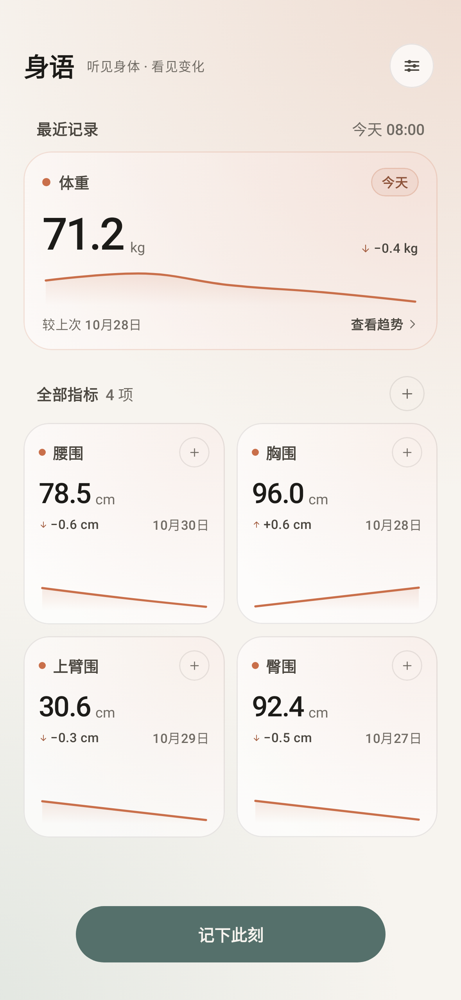
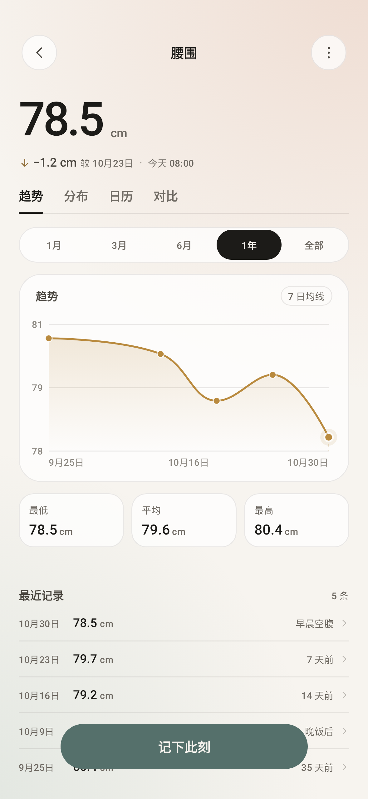
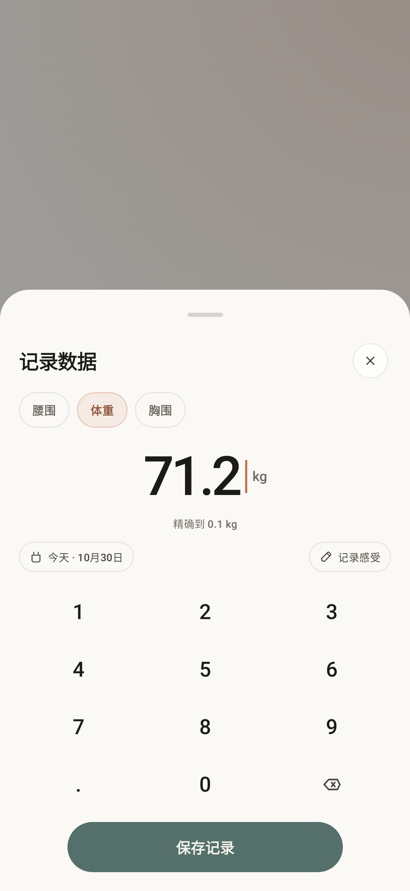
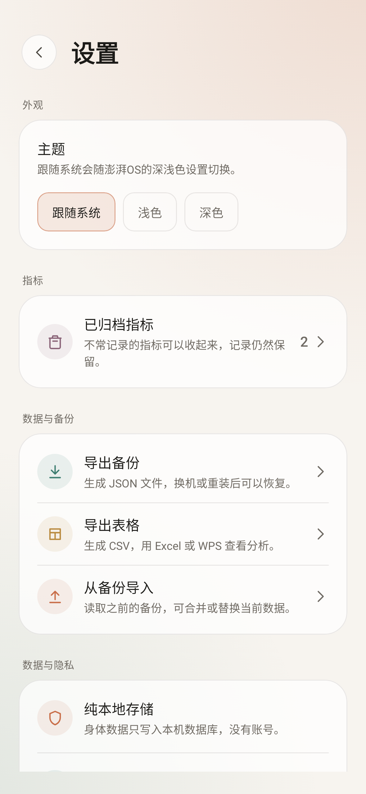

# 身语 · BodyVoice

身语是一款本地优先的身体数据记录 Android 应用。所有身体数据只保存在本机数据库，没有账号、没有云同步，也不申请网络权限。

> 听见身体，看见变化。

## 截图

| 首页 | 指标详情 |
| --- | --- |
|  |  |
| **快速记录** | **设置** |
|  |  |

## 功能

- **指标管理**：自定义名称、单位、精度与配色，支持归档和恢复。
- **快速记录**：底部数字键盘，常用指标一键记录。
- **派生指标**：基于已有指标编写公式，自动计算衍生数据。
- **趋势图表**：趋势、分布、日历、对比四种视图，平滑曲线呈现变化。
- **备份迁移**：JSON 完整备份、CSV 导出，支持合并或替换导入。
- **本地优先**：无 INTERNET 权限，数据只写入本机 Room 数据库。
- **体验适配**：深浅色主题、平板布局、200% 字体缩放。
- **支持作者**：设置内可扫码赞赏，长按二维码可保存到相册。

## 技术栈

Kotlin · Jetpack Compose · Material 3 · Hilt · Room · DataStore · Navigation Compose

- 包名：`com.liangji.bodymeasure`
- minSdk 26 / targetSdk 37 / compileSdk 37
- 构建工具链：JDK 17、Gradle 9.6、AGP 9.4

## 构建

1. 安装 JDK 17 与 Android SDK Platform 37。
2. 用 Android Studio 打开项目，或在 `local.properties` 中配置 `sdk.dir`。
3. 构建 Debug 包：

```bash
./gradlew assembleDebug
```

运行单元测试与 lint：

```bash
./gradlew testDebugUnitTest lintDebug
```

Release 构建需要本地的 `keystore.properties` 与签名文件，它们不会提交到仓库。

## 隐私

- 不申请 `INTERNET` 权限，无网络请求、无账号、无云备份。
- 数据只保存在本机，卸载应用会删除全部记录。
- 建议定期在设置中导出 JSON 备份。

## 许可

[MIT](LICENSE)

## 作者

skogling
